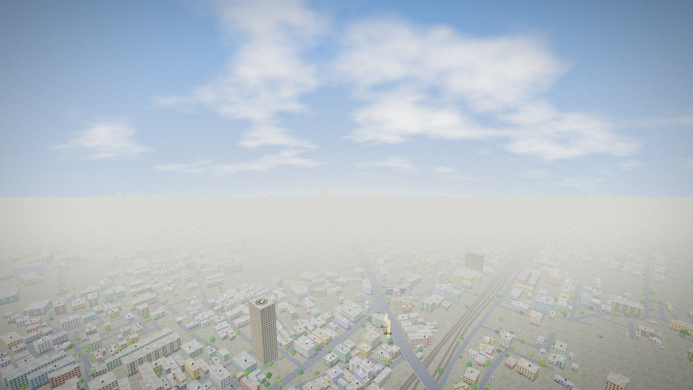
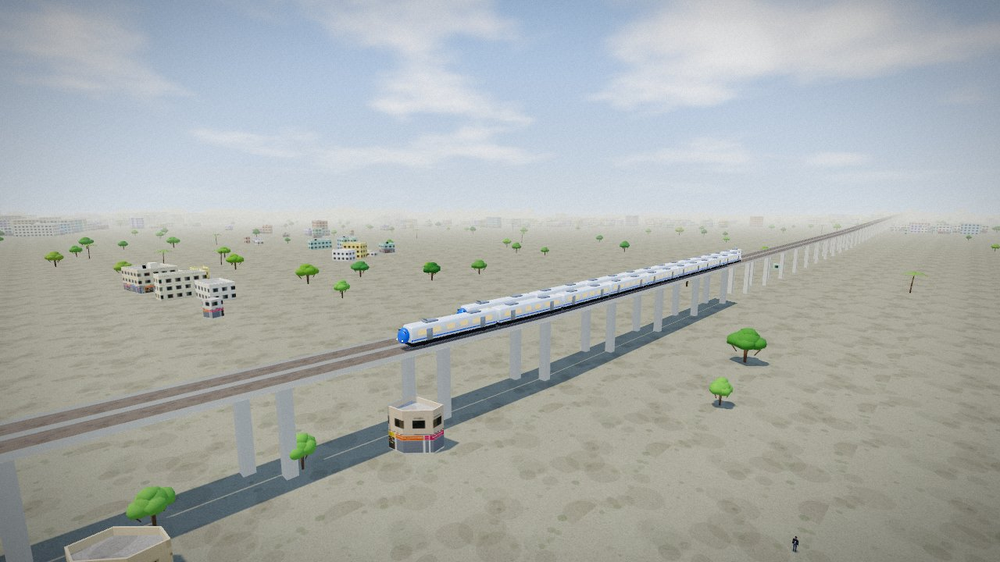
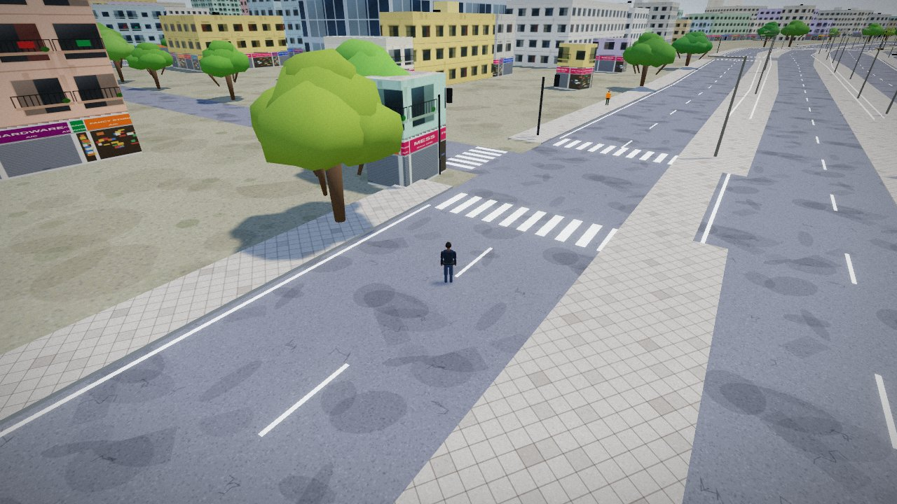
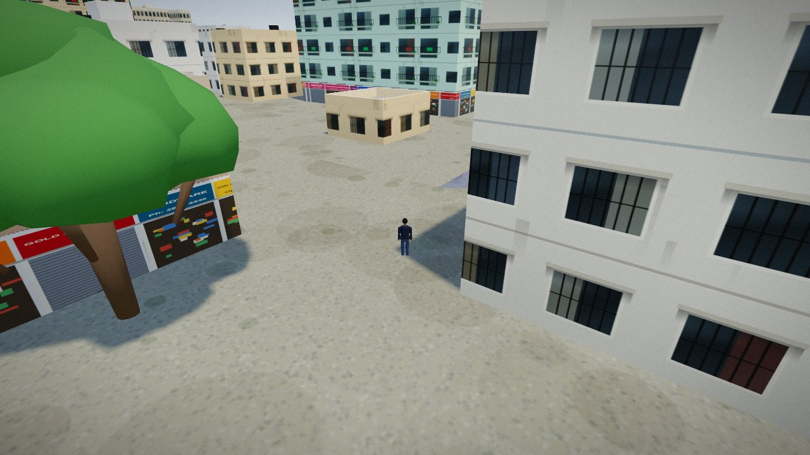
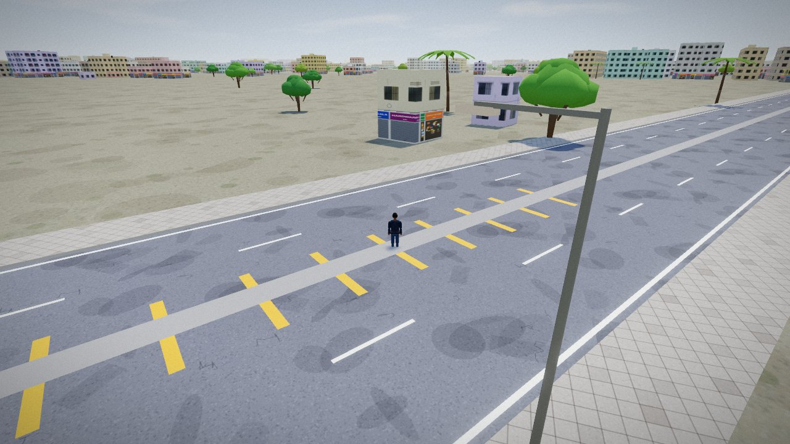

# Vapi Hustle

An open-world crime game set on about 200 km² of real **Vapi (Valsad, Gujarat)** and **Daman** streets. It runs in the browser with Three.js and needs no install. Play with keyboard and mouse, or with a PS4/PS5 controller.

The game is a fork of [Madras Hustle](https://github.com/shreyans-chowdry/madras-hustle) by Shreyans Chowdry, which is set in Chennai. The engine is the same. The city, the data pipeline, the missions and the characters were rebuilt for Vapi.



| | |
|---|---|
|  |  |
| Bullet trains on the Mumbai–Ahmedabad viaduct | Main road at the GIDC |
|  |  |
| Moti Daman | Road to Daman Airport |

## What's in Vapi

| Area | What's there |
|---|---|
| **The map** | About 16 × 12 km, from Daman's coast to Chanod and Karvad, and from Bagwada down to Balitha and Salvav. It has 8,166 streets, 76,600 buildings, 41,000 trees, the Daman Ganga and Kolak rivers, and the Arabian Sea to the west |
| **Neighbourhoods** | Area names come from the data: Chala, GIDC, GIDC Char Rasta, Zanda Chowk, Imran Nagar, Balitha, Chanod, Dabhel, Kachigam, Salvav, Chharwada, Chhiri, Nani Daman, Moti Daman, Khariwad, Dunetha, Varkund and others. They are the address lines most used by Overture place listings, each placed at the median location of those listings |
| **Buildings** | Low GIDC sheds on the industrial estates (from the land-use data), 2–5 floor blocks in town, and high-rise towers around Chala and Vapi town. Temples and Jain derasars get a Nagara-style shikhara with a kalash and a saffron flag. Churches in Daman get a colonial facade. The Moti and Nani Daman fort walls stand as stone ramparts |
| **Rail** | The Western Railway main line runs through Vapi station and Bagwada halt. The *WR local* takes the place of the original game's metro: buy a ticket, go through the gates, board, ride the real line. White bullet trains run at 250 km/h on the 15 m-high Mumbai–Ahmedabad high-speed viaduct. Container rakes run on the Western Dedicated Freight Corridor |
| **Daman Airport** | The real runways (03/21 and 09/27), taxiways, aprons and helipad. A terminal with check-in, security and a boarding gate. Fly as a passenger on a scripted scenic flight over Devka beach, the forts and Vapi, or charter a prop plane and fly it yourself |
| **Sea and coast** | Devka, Jampore and Moti Daman beaches with coconut palms. Marinas at the Daman jetty and Jampore. Ships on the Arabian Sea |
| **Family and friends** | Mummy at the family home in Chharwada (dal-dhokli restores health), cousin Kunal, and Hetal's chai & nasto corner (cutting chai, khaman). Your choices change relationship scores |
| **Missions** | 16 missions. The original 12 were relocated to Vapi. The Arrival, Commuter Hustle and Family Favor were rewritten for Daman Airport, the WR local and Rajesh Kaka's garage in the GIDC. There is one new mission, **Dry State Run**: Salim's van of crates from the Daman jetty, past the Kachigam check post, to a GIDC godown |
| **Google Maps** | Press <kbd>J</kbd> to open a real Google map and Street View of the spot you are standing on. Clicking the Google map sets your in-game GPS route (see below) |
| **Money** | Rupees (₹, Indian digit grouping) |

## Play locally
```
python3 build.py        # writes dist/index.html and copies the world data
cd dist && python3 -m http.server 8000
```
Open http://localhost:8000. You need a web server; opening `index.html` directly won't load the map data or the 3D models.

## Google Maps panel (optional)

The 3D city contains **no Google data**: it is built only from open data (see below). Google Maps Platform appears in one place, the in-game panel (<kbd>J</kbd>, or *Google Maps view* in the pause menu). It turns your in-game position into latitude and longitude and shows:

- a **Google map** (Maps JavaScript API, satellite or road view) centred on you, with an **Advanced Marker** where you stand;
- the nearest outdoor **Street View** panorama, facing the way you face in the game;
- clicking the Google map sets the in-game GPS route to that spot. Only the clicked coordinate is used.

To enable it, you need a key with the **Maps JavaScript API** enabled. For free prototyping, get a **Maps Demo Key** at https://mapsplatform.google.com/maps-demo-key?utm_campaign=gmp_git_agentskills_v1 (sign in, accept the Demo Project terms, copy the key). Then use any one of these:
- paste the key into the panel (it is stored only in your browser), or
- open the game with `?gmapsKey=YOUR_KEY`, or
- build with `GOOGLE_MAPS_API_KEY=YOUR_KEY python3 build.py`. On Vercel, add `GOOGLE_MAPS_API_KEY` as an environment variable; `vercel.json` runs `python3 build.py`.

A browser key is always visible to players, so **restrict it** to your site's HTTP referrers and to the Maps JavaScript API: https://docs.cloud.google.com/api-keys/docs/add-restrictions-api-keys. The Demo Key has a daily limit and is not for production. With your own key, usage may incur costs on your Google Cloud billing account.

## Deploy to Vercel
Import the repo at vercel.com/new and choose Framework = Other. `vercel.json` already sets the build command (`python3 build.py`) and the output directory (`dist`). You can also drag and drop the folder, or run `vercel --prod`.

## Rebuild the map
The pipeline is in `data/`. It reads [Overture Maps](https://overturemaps.org) GeoParquet straight from its public S3 bucket and needs no DuckDB extensions:
```
pip install pyarrow shapely
python3 data/fetch_overture.py data/overture segment connector water land_use land infrastructure place building   # bbox via BBOX=W,S,E,N
BBOX=72.6,20.1,73.2,20.7 python3 data/fetch_overture.py data/overture division
python3 data/overture_to_osm.py   # Overture -> OSM-style nodes/ways/relations (data/osm_vapi.pkl)
python3 data/process_vapi.py      # road graph, water/sea, rails + viaduct heights, airport, buildings, trees -> data/world2.json
python3 data/pack.py              # delta-encode and split into data/world-a.json + data/world-b.json
python3 build.py
```
The default box is `72.805,20.335,72.965,20.445`, and the release is pinned with `OVERTURE_RELEASE` (default `2026-10-21.0`). Other changes from the Chennai pipeline:
- the sea comes from Overture's ocean polygon and lies to the **west**;
- rail pieces are chained through junctions by the straightest continuation, so the WR main line stays one line through Vapi yard;
- the bullet-train corridor is tagged as a viaduct;
- the airport terminal is the largest building beside the apron;
- POIs mark the footprints they stand in, so temples, churches, stadiums and malls get their styles.

## Controls
Same as Madras Hustle (full list in the pause menu): WASD move or drive, mouse camera, **F** enter or exit vehicles and board trains, **E** interact, **G** headlights or landing gear, **M** map, **J** Google Maps panel, **T** taxi and auto rides, **P/Esc** pause, **`** cheat console (`HEALME`, `GIVECASH n`, `SPAWNCAR type`, `SETWEATHER rain`, `CLEARWANTED`, `SKYFALL`).

## Tests
```
cd tools/e2e && npm install
node run.mjs loops.mjs     # boots the real game headless and plays every loop: 22/22 checks pass
node run.mjs smoke.mjs     # quick boot report (stations, properties, missions, services)
node run.mjs shots.mjs     # re-renders docs/screenshots
```
The 22 checks cover:
- boot, cheats and the save sanitiser;
- driving with gears, reverse and headlights;
- Daman terminal check-in, security, gate, charter take-off, and a passenger flight from take-off to landing;
- the WR local from Vapi to Bagwada;
- dialogue with Mummy, and missions m13, m14 and m15 played to the end, plus a fail condition;
- the Google Maps panel: key prompt, lat/lng round trip, and clean failure when the API can't load;
- m16's route, the fall-through failsafe, and platform collision layers.

## Credits and licences
- Map data: © [Overture Maps Foundation](https://docs.overturemaps.org/attribution), including © OpenStreetMap contributors (ODbL), Google Open Buildings (CC BY 4.0 / ODbL), Microsoft ML Building Footprints (ODbL) and TomTom (ODbL).
- Engine, Blender models and original game: Madras Hustle by Shreyans Chowdry.
- Google Maps panel: this app includes Google Maps features and content. Their use is subject to the [Google Maps / Google Earth Additional Terms of Service](https://maps.google.com/help/terms_maps.html) and the [Google Privacy Policy](https://policies.google.com/privacy). Developers deploying it are subject to the [Google Maps Platform Terms of Service](https://cloud.google.com/maps-platform/terms?utm_campaign=gmp_git_agentskills_v1).
- All characters, businesses in missions and storylines are invented.
